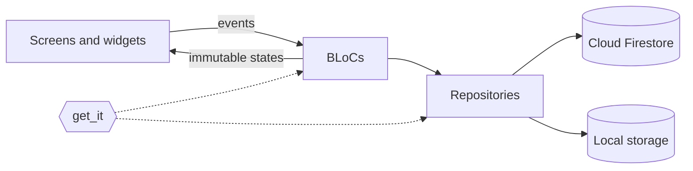
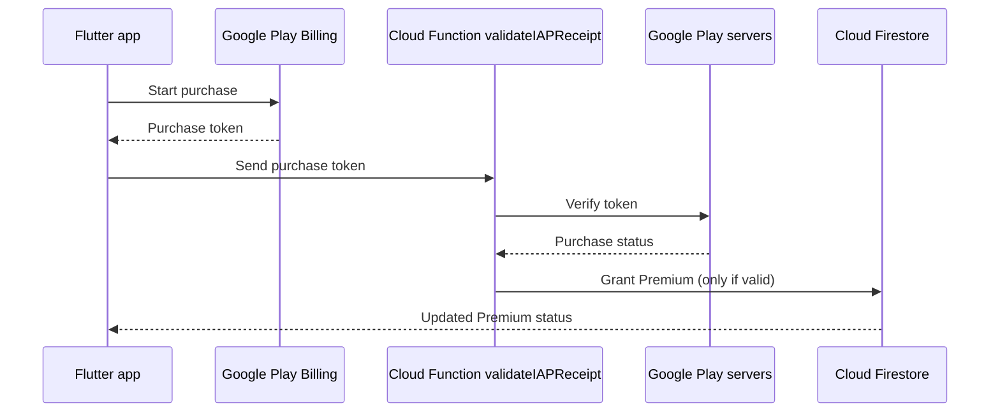

<!-- markdownlint-disable MD033 MD041 MD029 -->
<div align="center">
  
  <h1>Vowl</h1>
  <p><b>A gamified language-learning app built with Flutter and Firebase.</b></p>

  [](https://flutter.dev)
  [](https://dart.dev/)
  [](https://firebase.google.com/)
  [](https://bloclibrary.dev/)
  
</div>

---

## Overview

Vowl is a gamified language-learning app designed for general learners (ages 13+). It has **100+ game types**, a **200-level curriculum per game**, and **60,000+ learning challenges** across vocabulary, grammar, listening, speaking, reading, writing, and more.

I designed and built everything myself: the Flutter app, the Firebase backend, and the Cloud Function that validates in-app purchases.

**Status:** Google Play release in progress.

[Features](#features) · [Architecture](#architecture) · [Security](#security-and-backend) · [Design decisions](#design-decisions) · [Getting started](#getting-started)

### Technical highlights

- **BLoC + get_it:** business logic lives in BLoCs, and dependencies are injected, so services are easy to swap and test.
- **Shared game logic:** a generic `GameScreenMixin<T>` removes duplicated timer, scoring, lifecycle, and haptics code across 60+ game screens.
- **Server-side purchase validation:** a Node.js Firebase Cloud Function verifies Google Play purchase tokens before Premium is granted.
- **Security Rules:** Firestore and Cloud Storage rules restrict users to their own data and validate XP updates.
- **Speech and audio:** speech recognition and text-to-speech for speaking and listening games.
- **UI and rendering:** a glassmorphic interface built with `flutter_animate`, plus an animated mesh-gradient background drawn with `CustomPainter`.

<!--
## Screenshots

Add real screenshots to docs/screenshots/ and uncomment this section.

<div align="center">
  
  
  
</div>

Demo video: [Watch on YouTube](PASTE_YOUR_VIDEO_LINK_HERE)
-->

---

## Features

### 1v1 Staking Arena & PvP Duels

- **Live Matchmaking**: 3-second rapid match pairing with coin stakes (30🪙 entry stake, 50🪙 winner prize).
- **Custom Room Invites**: Instant room code generation with direct viral sharing links (`https://vowl.app/duel/{code}`).
- **Staking Safety Net**: Automatic coin refunds if network pairing or opponent connection drops unexpectedly.
- **Real-Time Overtake HUD**: In-game alerts notifying learners the exact moment their score passes their closest rival.

### Dual-Timeframe Leaderboard & Weekly League System

- **Dual-Timeframe Rankings**: Switch seamlessly between **"This Week"** (resets Sunday 23:59:59 UTC) and **"All Time"**.
- **Weekly League Tiers & Countdown**: Tier rewards banner with a live countdown timer to the weekly reset.
- **Hall of Fame**: Visual celebration showcasing past weekly league champions.
- **Transparent Progression Logic**: Deterministic, unmocked ranking (XP primary, Streak secondary, Last Active timestamp tiebreaker).

### Offline Multi-Language Translation Suite

- **100% Free On-Device Machine Learning**: Powered by Google ML Kit Translation (`google_mlkit_translation`) with **$0.00 cloud API costs** and complete offline resilience across 50+ language pairs.
- **Instant Language Translation**: Full offline translation and vocabulary lookup for multi-language learners.
- **Word Bank Integration**: Save any translated or discovered word directly into the user's personal review deck (`DailyWordsService`).

### Viral Referral & VIP Extension Engine

- **Milestone Rewards**: Earn coins, gems, and VIP days by inviting friends (`https://vowl.app/ref/{code}`).
- **Fair Dual-Status Granting**: Free users unlock fresh VIP days (+3 days for milestone #1), while active Premium subscribers have their expiration date extended automatically.
- **Fraud Prevention**: Device and account verification preventing self-referral and loop exploits.

### Sound Design & Dynamic Audio Hierarchy

- **Dual-Player Isolation**: Dedicated primary player for instant micro-interactions (clicks, correct/wrong) and independent overlay player for victory fanfares so celebratory audio never clips gameplay feedback.
- **Dynamic Combo Pitch Scaling**: Pitch ascends with consecutive streaks (1.00x → 1.12x → 1.25x).
- **Non-Punitive Feedback**: Gentle wooden clunk on mistakes, preventing anxiety and encouraging persistence.
- **Comparative Dual-Speed TTS**: Natural speech followed by slowed articulation for listening mastery.
- **Coin Tally Chime**: Rapid micro-ticker chimes synced with victory coin counter animations.

### Timezone-Aware Psychology Notifications

- **Global Reset Alignment**: Weekly league resets at Sunday 23:59:59 UTC across all players worldwide.
- **Local Timezone Scheduling**: Daily engagement notifications (9:00 AM morning motivation, 8:00 PM evening streak saver) execute strictly according to the learner's **device local timezone**, ensuring international users are never disturbed during sleep.

### Tri-Theme Design System

- **Light Mode**: Clean, high-readability slate surfaces (`AppColors.slate50` background, pure white cards).
- **Dark Mode**: Premium deep slate surfaces (`AppColors.slate900` background, `AppColors.slate800` cards).
- **Midnight AMOLED Mode**: Pure black canvas (`Colors.black` scaffold, `AppColors.midnightSurface` cards, and subtle `0xFF1E293B` borders) engineered for OLED battery saving and zero eye glare.

### Games and curriculum

- 100+ game types, including vocabulary, grammar, pronunciation, typing, matching, and listening comprehension.
- Up to 200 levels per game. Curriculum content is bundled as assets and organized by category (`assets/curriculum/`).
- Games pause and resume with the app lifecycle through a custom `AppLifecycleHandler`.
- Haptic and sound feedback for correct and wrong answers, managed in one place.

### Speech and audio

- Speech recognition for speaking and pronunciation exercises.
- Text-to-speech for listening games.

### Progress and rewards

- XP and level system.
- Timezone-aware daily streaks.
- Achievements, badges, and leaderboards.

### Explore & Utilities Hub

- Daily curated 5-word accelerator (`DailyWordsService`).
- Offline 50+ languages translation suite powered by Google ML Kit Translation.

### Accounts and monetization

- OAuth (Google Sign-In) and email login.
- AdMob banner and interstitial ads.
- Premium subscriptions and one-time coin packs through Google Play Billing.
- Razorpay integration as an alternative payment gateway for the Indian market, subject to Google Play's payments policy.

---

## Architecture



The project uses a feature-first structure:

```text
lib/
├── core/
│   ├── presentation/      # Shared mixins and base widgets (e.g. GameScreenMixin)
│   ├── theme/             # AppTheme (Light/Dark/Midnight), color tokens, dimensions
│   └── utils/             # SoundService, HapticService, notification schedulers
├── features/
│   ├── arena/             # 1v1 Staking Arena, matchmaking, duels
│   ├── auth/              # OAuth, email login, legal consents
│   ├── games/             # The 100+ game types & category maps
│   ├── home/              # Bento dashboard, quick stats, daily goal
│   ├── leaderboard/       # Dual-timeframe rankings, leagues, Hall of Fame
│   ├── monetization/      # IAP repositories, paywalls, coin packs
│   ├── profile/           # Streaks, trophy room, settings
│   ├── referral/          # Viral invite engine, VIP extension
├── config/                # Environment variables, keys
└── main.dart              # Entry point and DI setup
extensions/                # Infrastructure-as-Code for Firebase Extensions
└── delete-user-data.env   # Safe, non-secret configuration (Firebase Best Practice)
functions/
├── index.js               # Server-side purchase validation (Node.js)
└── package.json           # googleapis, firebase-admin
```

> **Note on Infrastructure-as-Code:** The `extensions/` directory is safely committed to source control following Firebase's modern "Extensions-as-Code" architecture. It contains structural configuration parameters (like Firestore deletion paths) and no sensitive secrets, ensuring infrastructure reproducibility across environments.

### State management: BLoC

Business logic lives in BLoCs. Widgets send events (for example `SubmitAnswerEvent` and `PauseGameEvent`) and rebuild from immutable states.

### Dependency injection: get_it

Repositories, network clients, and local storage managers are registered with `get_it`, so they can be replaced or mocked.

### Shared game logic: mixins

60+ game screens need the same timer ticks, score tracking, lifecycle pausing, and haptics. A generic `GameScreenMixin<T>` keeps that logic in one place, and screens add feature-specific behavior with extra mixins, for example `with GameScreenMixin<Widget>, GrammarFeatureMixin`.

### Rendering performance

The animated background uses `CustomPainter` instead of image assets. It batches points with `canvas.drawPoints` and minimizes allocations inside the paint loop to keep the animation smooth. Debug logging is wrapped in `kDebugMode`, so it does not run in release builds.

---

## Security and backend

The app treats the client as untrusted. It does not decide that a purchase is valid: it sends the purchase token to a Cloud Function, which verifies it with Google Play and then grants Premium in Firestore.



The function is written in Node.js and uses `googleapis` and `firebase-admin`.

### Firestore and Storage Security Rules

- Users can read and write only their own documents (`request.auth.uid == resource.id`).
- Rules validate XP updates (values must stay within valid bounds) to limit client-side tampering.

---

## Design decisions

| Decision | Why | Trade-off |
| --- | --- | --- |
| BLoC for state | Games have many state changes (timer, score, pause, answers). Events and immutable states keep transitions predictable and testable. | More boilerplate than Provider or Cubit for simple screens. |
| One generic `GameScreenMixin<T>` | 60+ game screens share timers, scoring, lifecycle pausing, and haptics. | Mixins can hide dependencies; a separate controller class would be more explicit. |
| Curriculum bundled as assets | Content works offline and costs no database reads. | Larger app size, and new content needs an app release. |
| Server-side purchase validation | The client cannot be trusted to say that a purchase happened. | Needs a Cloud Function and Google service-account setup to maintain. |
| `CustomPainter` for the animated background | Avoids heavy image assets and expensive layout work. | Custom painting code is harder to maintain than widgets. |

---

## Tech stack

| Area | Technologies |
| --- | --- |
| App | Flutter, Dart |
| State and DI | flutter_bloc, equatable, get_it |
| Navigation | go_router |
| Backend | Firebase Auth, Cloud Firestore, Cloud Storage, Cloud Functions (Node.js) |
| Payments and ads | in_app_purchase (Google Play Billing), razorpay_flutter, google_mobile_ads |
| Voice and audio | speech_to_text, flutter_tts, audioplayers |
| UI | flutter_animate, flutter_screenutil, shimmer, cached_network_image |

---

## Getting started

### Prerequisites

- Flutter SDK (stable channel)
- Node.js and the Firebase CLI (for Cloud Functions)
- A Firebase project
- A Google Play Console account (for testing in-app purchases)

### Run the app

1. Clone the repo:

```bash
   git clone https://github.com/vowl-official/vowl-app.git
   cd vowl-app
```

2. Install dependencies:

```bash
   flutter pub get
```

3. Create a `.env` file in the project root. It is bundled as an asset and loaded with `flutter_dotenv`, so anyone can read it from the built app. Put only public identifiers in it (for example a Razorpay key ID) and keep all secrets on the server.

4. Add your Firebase config files:
   - Android: `android/app/google-services.json`
   - iOS: `ios/Runner/GoogleService-Info.plist`

5. Deploy the Cloud Function (needed for purchase validation):

```bash
   cd functions
   npm install
   firebase deploy --only functions:validateIAPReceipt
```

6. Run the app:

```bash
   flutter run
```

---

## Legal

Official policies hosted on production domain (`vowl.in`):

- [Privacy Policy](https://vowl.in/privacy.html)
- [Terms of Service](https://vowl.in/terms.html)
- [Refund Policy](https://vowl.in/refund.html)

---

<p align="center">Built by <b>Vowl Team</b> · <a href="https://github.com/vowl-official">GitHub</a> </p>

<!-- When live on Google Play: replace the "status" badge at the top with this -->
[](https://play.google.com/store/apps/details?id=YOUR.APP.ID)

<!-- After you have real tests + .github/workflows/ci.yml: add this section -->
## Testing

```bash
flutter analyze
flutter test
```

[](https://github.com/vowl-official/vowl-app/actions/workflows/ci.yml)

<!-- Only after you verify your rules block client writes to entitlement fields: add to the Security Rules list -->
- Clients cannot write entitlement fields such as Premium; only the Cloud Function can.
